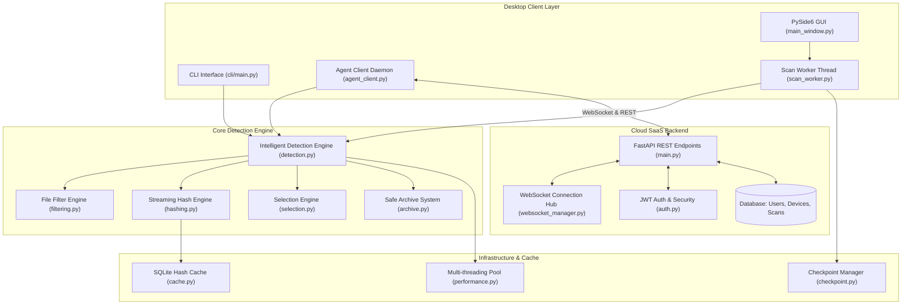

# 📦 Phase 1: Project Inventory & Repository Discovery

> **Document Type:** Project Inventory & Technical Baseline  
> **Author:** Senior Business Analyst / Technical BA  
> **Target Project:** Duplicate Bin (`duplicate-bin`)  
> **Analyzed Version:** v0.2.0 (Hybrid SaaS Transition)  
> **Repository Root:** `c:\Users\mustafa\Desktop\duplicate-bin`  
> **Analysis Date:** October 2026  

---

## 1. Executive Identification

| Attribute | Verified Value from Repository | Evidence Source |
|---|---|---|
| **Project Name** | **Duplicate Bin** (`DuplicateBin`) | [README.md](file:///c:/Users/mustafa/Desktop/duplicate-bin/README.md#L1), [setup.py](file:///c:/Users/mustafa/Desktop/duplicate-bin/setup.py#L8), [DuplicateBin.spec](file:///c:/Users/mustafa/Desktop/duplicate-bin/DuplicateBin.spec#L26) |
| **Current Version** | `0.2.0` (core desktop package), `1.0.0` (FastAPI SaaS backend) | [README.md](file:///c:/Users/mustafa/Desktop/duplicate-bin/README.md#L6), [backend/app/main.py](file:///c:/Users/mustafa/Desktop/duplicate-bin/backend/app/main.py#L18), [duplicate_bin/__version__.py](file:///c:/Users/mustafa/Desktop/duplicate-bin/duplicate_bin/__version__.py#L3) |
| **Application Type** | Hybrid Architecture: Native Desktop Utility (Qt6/PySide6) + Background Service Daemon + Central Cloud SaaS Web Backend (FastAPI REST & WebSockets) | [run.py](file:///c:/Users/mustafa/Desktop/duplicate-bin/run.py#L33-L63), [backend/app/main.py](file:///c:/Users/mustafa/Desktop/duplicate-bin/backend/app/main.py#L1-L393), [docs/TECHNICAL_ARCHITECTURE.md](file:///c:/Users/mustafa/Desktop/duplicate-bin/docs/TECHNICAL_ARCHITECTURE.md#L8-L48) |
| **Business Domain** | **Storage Optimization, Data Deduplication, Digital Asset Management, Enterprise Storage Governance** | [docs/SAAS_ANALYSIS_AND_STRATEGY.md](file:///c:/Users/mustafa/Desktop/duplicate-bin/docs/SAAS_ANALYSIS_AND_STRATEGY.md#L8-L27) |
| **Primary License** | MIT License | [LICENSE](file:///c:/Users/mustafa/Desktop/duplicate-bin/LICENSE#L1), [setup.py](file:///c:/Users/mustafa/Desktop/duplicate-bin/setup.py#L22) |

---

## 2. Business Purpose & Problem Solved

### Business Problem
Modern digital workflows generate exponential data duplication:
1. **Creators & Prosumers:** Photographers, video editors, and designers generate gigabytes of identical RAW/JPEG assets, draft exports, and redundant project folders, triggering costly personal cloud storage upgrades (Google Drive, Dropbox, iCloud) or exhausting SSD storage.
2. **Corporate Teams & SMEs:** Distributed office workstations, shared Network-Attached Storage (NAS), and creative team drives suffer from version duplication (`Draft_v1`, `Draft_v2_Final`, `Draft_v2_Final_edited`), leading to uncontrolled storage billing, fragmented single sources of truth, and unmonitored disk capacity limits.
3. **Data Loss Fear:** End users resist manual cleanups due to fear of accidentally deleting unique originals or breaking critical application paths.

*Evidence:* [docs/SAAS_ANALYSIS_AND_STRATEGY.md](file:///c:/Users/mustafa/Desktop/duplicate-bin/docs/SAAS_ANALYSIS_AND_STRATEGY.md#L30-L48).

### Solution Delivered
**Duplicate Bin** provides an intelligent, automated, multi-tiered deduplication ecosystem:
- **Zero-Risk Deletion:** Moves redundant files to a safety archive (`~/.duplicate_bin/`) with instant single-click restoration, preventing accidental data loss.
- **High-Throughput Local Engine:** Multi-algorithm cryptographic hashing (SHA-256, MD5, CRC32, BLAKE2b), two-pass size pre-filtering, and Union-Find graph clustering to group duplicates without false positives.
- **Hybrid SaaS Telemetry & Management:** Allows centralized management of distributed devices via WebSocket pairing, telemetry tracking, and pay-as-you-go credit-based billing.

*Evidence:* [docs/TECHNICAL_ARCHITECTURE.md](file:///c:/Users/mustafa/Desktop/duplicate-bin/docs/TECHNICAL_ARCHITECTURE.md#L52-L89), [backend/app/main.py](file:///c:/Users/mustafa/Desktop/duplicate-bin/backend/app/main.py#L149-L290).

---

## 3. Target Users & Stakeholders

| Role / Segment | Description | System Interaction | Evidence |
|---|---|---|---|
| **Content Creators / Prosumers** | Photographers, videographers, independent software developers. | Native Desktop GUI (PySide6), Drag-and-drop folders, side-by-side media preview. | [docs/SAAS_ANALYSIS_AND_STRATEGY.md](file:///c:/Users/mustafa/Desktop/duplicate-bin/docs/SAAS_ANALYSIS_AND_STRATEGY.md#L32-L39), [duplicate_bin/ui/preview_widget.py](file:///c:/Users/mustafa/Desktop/duplicate-bin/duplicate_bin/ui/preview_widget.py#L1-L150) |
| **IT & Office System Admins** | Corporate system administrators managing shared team drives and local NAS storage. | CLI automation (`run.py scan`), Headless daemon (`run.py service`), Central SaaS Dashboard. | [run.py](file:///c:/Users/mustafa/Desktop/duplicate-bin/run.py#L52-L63), [duplicate_bin/cli/main.py](file:///c:/Users/mustafa/Desktop/duplicate-bin/duplicate_bin/cli/main.py#L1-L120) |
| **Team Managers / Business Owners** | Budget owners wanting visibility into corporate storage waste and cloud expense reduction. | Cloud Dashboard stats (`/api/dashboard/stats`), credit ledger, centralized subscription billing. | [backend/app/main.py](file:///c:/Users/mustafa/Desktop/duplicate-bin/backend/app/main.py#L202-L243), [docs/SAAS_ANALYSIS_AND_STRATEGY.md](file:///c:/Users/mustafa/Desktop/duplicate-bin/docs/SAAS_ANALYSIS_AND_STRATEGY.md#L40-L48) |
| **Security & Compliance Officers** | Governance professionals ensuring data privacy and system safety. | Audit trail validation, path traversal restrictions, local-only processing verification. | [docs/SECURITY_COMPLIANCE.md](file:///c:/Users/mustafa/Desktop/duplicate-bin/docs/SECURITY_COMPLIANCE.md#L1-L100), [duplicate_bin/core/utils.py](file:///c:/Users/mustafa/Desktop/duplicate-bin/duplicate_bin/core/utils.py#L1-L80) |

---

## 4. Complete Technology Stack Audit

### A. Desktop Client Application
- **Language:** Python 3.8+ ([README.md](file:///c:/Users/mustafa/Desktop/duplicate-bin/README.md#L8))
- **GUI Framework:** PySide6 (Qt 6.6+) ([requirements.txt](file:///c:/Users/mustafa/Desktop/duplicate-bin/requirements.txt#L4))
- **UI Architecture:** MVC / Signal-Slot pattern with QMainWindow, custom widgets (`DropZoneWidget`, `FilePreviewWidget`, `ArchiveTreeWidget`), QThread worker decoupling (`scan_worker.py`).
- **Cryptographic / Hashing Algorithms:** Python standard `hashlib` (SHA-256, MD5, BLAKE2b), `zlib` (CRC32), optional `xxhash`.
- **Media & Content Analysis:** `Pillow` (PIL) for image thumbnailing, `mutagen` for audio ID3 tags, `PyPDF2` for PDF document metadata, custom binary chunk diff.
- **Local Persistence & Caching:** SQLite database (`~/.cache/duplicate-bin/hash_cache.db`) with Write-Ahead Logging (WAL) mode for concurrency, JSON-based scan checkpointing.
- **Configuration Management:** YAML configuration (`pyyaml`) stored in `~/.config/duplicate-bin/config.yaml`.
- **System Integration:** Cross-platform path normalization, symlink resolution, system folder protection (`/bin`, `/etc`, `C:\Windows`, `C:\Program Files`).

### B. SaaS Backend & Cloud Relay
- **Framework:** FastAPI (Python ASGI framework) ([backend/app/main.py](file:///c:/Users/mustafa/Desktop/duplicate-bin/backend/app/main.py#L18))
- **Server:** Uvicorn ASGI web server ([backend/requirements.txt](file:///c:/Users/mustafa/Desktop/duplicate-bin/backend/requirements.txt#L2))
- **Database ORM:** SQLAlchemy 2.0+ ([backend/app/database.py](file:///c:/Users/mustafa/Desktop/duplicate-bin/backend/app/database.py#L1-L15))
- **Database Engine:** SQLite (local development / embedded) with PostgreSQL compatibility schema ([backend/app/models.py](file:///c:/Users/mustafa/Desktop/duplicate-bin/backend/app/models.py#L1-L54))
- **Authentication:** JWT (JSON Web Tokens) with HS256 algorithm via `python-jose`, password hashing via `passlib[bcrypt]` ([backend/app/auth.py](file:///c:/Users/mustafa/Desktop/duplicate-bin/backend/app/auth.py#L1-L60))
- **Real-Time Communication:** Fast WebSockets (`/ws/agent`, `/ws/dashboard`) via custom in-memory connection manager (`websocket_manager.py`).
- **Validation & Serialization:** Pydantic models for schemas ([backend/app/schemas.py](file:///c:/Users/mustafa/Desktop/duplicate-bin/backend/app/schemas.py#L1-L85)).

### C. Build, Packaging & Distribution
- **Linux:** Native Debian packaging scripts (`build_debian.sh`, `debian/control`, `debian/rules`), XDG `.desktop` launcher, mime type icons ([build_debian.sh](file:///c:/Users/mustafa/Desktop/duplicate-bin/build_debian.sh#L1-L150)).
- **Windows:** PyInstaller single-executable spec (`DuplicateBin.spec`, `build_windows.py`, `build_windows.bat`, `build_windows.ps1`).
- **macOS:** Darwin compatibility in path detection and tray icons.

---

## 5. Major Modules & Architectural Components

*Evidence:* [duplicate_bin/core/detection.py](file:///c:/Users/mustafa/Desktop/duplicate-bin/duplicate_bin/core/detection.py), [duplicate_bin/engine/archive.py](file:///c:/Users/mustafa/Desktop/duplicate-bin/duplicate_bin/engine/archive.py), [backend/app/main.py](file:///c:/Users/mustafa/Desktop/duplicate-bin/backend/app/main.py).

---

## 6. Feature Catalog: The 30 Core Features

The repository documents and implements 30 specialized features (detailed in [docs/FEATURES_COMPLETE.md](file:///c:/Users/mustafa/Desktop/duplicate-bin/docs/FEATURES_COMPLETE.md#L1-L40)):

1. **Multi-Algorithm Hashing:** SHA-256, MD5, CRC32, BLAKE2b, xxHash.
2. **Content-Aware Analysis:** Domain parsers for images, audio (ID3), documents (PDF).
3. **Fuzzy Matching:** Configurable similarity threshold (e.g. 0.95) for near-duplicate identification.
4. **Metadata Comparison:** EXIF date/camera, ID3 bitrate/album, PDF author/page count.
5. **Binary Diff Analysis:** Byte-by-byte discrepancy inspection.
6. **Advanced Filtering System:** Filtering by min/max size, modification date, file extensions, regex pattern inclusions/exclusions.
7. **Smart Selection Strategies (8 Modes):** Keep Newest, Keep Oldest, Keep Largest, Keep Smallest, Keep Best Quality, Keep Deepest Path, Keep Shortest Path, Custom Priority Rules.
8. **Multi-Threaded Processing:** Parallel hash calculations with thread pool allocation (1-16 threads).
9. **Real-Time Progress Tracking:** Files scanned per second, throughput (MB/s), estimated time remaining (ETA).
10. **Persistent Hash Cache:** SQLite database storing file signatures (path + size + mtime -> hash) to bypass re-computation.
11. **Incremental Scanning:** Checkpoint recovery in JSON to resume scans interrupted by user or crash.
12. **Streaming Memory Optimization:** File chunk streaming (4KB to 1MB adaptive) keeping memory usage bounded below 100MB regardless of multi-gigabyte file sizes.
13. **Performance Engine:** Adaptive concurrency tuning based on physical CPU core availability.
14. **Analytics Dashboard:** Graphical overview of recoverable bytes, duplicate count, and scan duration.
15. **Multi-Format Reporting:** Exportable audit reports in HTML, JSON, and CSV formats.
16. **File Type Distribution:** Breakdown analysis across Video, Image, Audio, Document, Code, and Archives.
17. **Storage Impact Analysis:** Visual financial and capacity savings breakdown.
18. **Comprehensive Audit Trail:** Persistent log files capturing every file manipulation and operation.
19. **Safe Archive Management:** Soft-quarantine with timestamped directory nesting and full restoration.
20. **Visual File Preview System:** High-performance thumbnailing with LRU cache memory cap (200 pixmaps).
21. **Enhanced Tree View:** Multi-column QTreeWidget displaying file paths, sizes, hashes, and match groups.
22. **Modern Dark Theme:** Custom CSS/QSS gradient-based theme.
23. **Responsive Split-Pane Layout:** Resizable QSplitter panels accommodating any screen resolution.
24. **YAML Configuration System:** Hierarchical user settings persisted across sessions.
25. **System Directory Protection:** Hardcoded blacklist blocking destructive operations against system roots (`C:\Windows`, `/usr`, `/etc`, etc.).
26. **Command-Line Interface (CLI):** Full headless execution capability for scripts and cron jobs.
27. **Drag & Drop Integration:** Intuitive folder ingestion directly onto the GUI interface.
28. **13 Global Keyboard Shortcuts:** Rapid accessibility for power users (`Ctrl+O`, `Ctrl+S`, `Ctrl+F`, `F1`, etc.).
29. **Extensible Plugin Architecture:** Hook-based event triggers (`on_scan_start`, `on_scan_complete`, `on_file_archived`).
30. **Multi-Language Support (i18n):** UI translations for English, Spanish, French, German, Chinese, and Japanese.

---

## 7. Known Limitations & Technical Debt (BA Findings)

| Area | Verified Finding | Business Impact | Source Evidence |
|---|---|---|---|
| **Internationalization (i18n)** | UI contains a language switcher, but many internal dialog strings remain hardcoded in English. | Limits non-English enterprise adoption; international localization testing will flag defects. | [docs/TECHNICAL_ARCHITECTURE.md](file:///c:/Users/mustafa/Desktop/duplicate-bin/docs/TECHNICAL_ARCHITECTURE.md#L155), [duplicate_bin/ui/main_window.py](file:///c:/Users/mustafa/Desktop/duplicate-bin/duplicate_bin/ui/main_window.py#L1-L200) |
| **Enterprise Cloud Storage Connectors** | Direct Google Drive, OneDrive, and Dropbox API scanners are defined in strategy roadmaps but not yet connected to the backend. | Users must mount cloud storage as local virtual sync folders to scan them. | [docs/SAAS_ANALYSIS_AND_STRATEGY.md](file:///c:/Users/mustafa/Desktop/duplicate-bin/docs/SAAS_ANALYSIS_AND_STRATEGY.md#L92-L95) |
| **Monolithic Script Heritage** | `scripts/duplicate_bin.py` contains ~6,200 lines of combined logic alongside the newer modularized `duplicate_bin/` package. | Maintenance overhead and duplicate code paths between `scripts/` and `duplicate_bin/`. | [scripts/duplicate_bin.py](file:///c:/Users/mustafa/Desktop/duplicate-bin/scripts/duplicate_bin.py#L1-L100), [setup.py](file:///c:/Users/mustafa/Desktop/duplicate-bin/setup.py#L1-L40) |
| **Perceptual Image Hashing (pHash)** | Near-duplicate image detection is currently based on metadata/fuzzy diff rather than full discrete cosine transform perceptual hashing (`imagehash` library). | Scaled or compressed versions of the same photo may not be recognized as duplicates without strict metadata. | [docs/TECHNICAL_ARCHITECTURE.md](file:///c:/Users/mustafa/Desktop/duplicate-bin/docs/TECHNICAL_ARCHITECTURE.md#L152) |

---

## 8. Business Analyst Assessment Summary

Duplicate Bin represents a mature desktop data engineering utility that has successfully proven its core computational algorithms (O(n) pre-filtering, Union-Find clustering, memory-safe streaming) and is actively transitioning into a multi-device SaaS management platform. In an interview, the candidate must frame this as a **high-volume storage optimization product balancing local zero-trust data privacy with cloud-coordinated telemetry and monetized credit management**.
