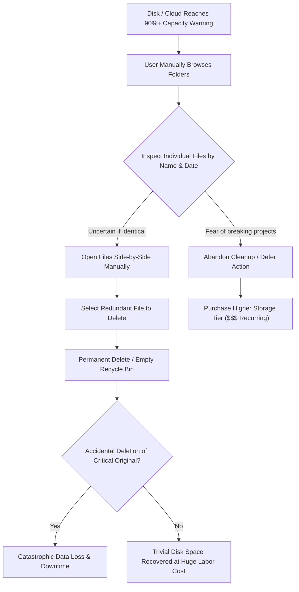
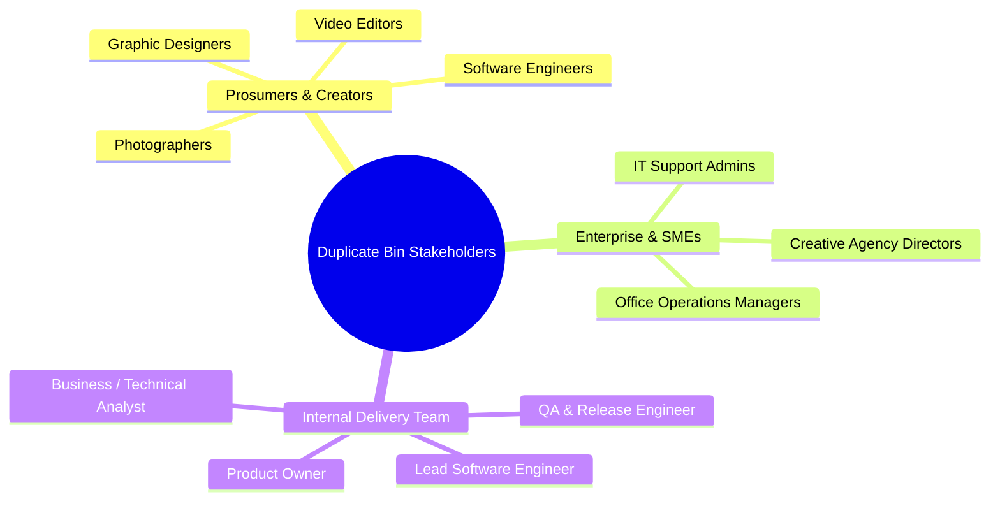

# 💼 Phase 2: Business Case & Strategic Problem Definition

> **Document Code:** BC-001  
> **Project:** Duplicate Bin Ecosystem  
> **Document Purpose:** Business Case, Problem Statement & Strategic Justification  
> **Prepared For:** Executive Stakeholders, Product Leadership & Interview Panels  
> **BA Lead:** Senior Technical Business Analyst  

---

## 1. Executive Summary

Storage sprawl is an escalating cost driver and operational bottleneck across both personal consumer computing and enterprise small-to-medium enterprise (SME) infrastructure. File redundancies account for between **15% and 35% of total consumed disk capacity** in unstructured data environments (downloads, media asset repositories, shared network folders, and project staging drives). 

**Duplicate Bin** delivers an enterprise-grade, hybrid deduplication solution combining a privacy-preserving, zero-cloud-upload local processing engine with a centralized SaaS telemetry and management platform. By automating the identification, grouping, smart selection, and risk-free archiving of redundant assets, the platform directly slashes storage subscription costs, frees up constrained local solid-state drive (SSD) space, and eliminates human errors during data cleanup.

---

## 2. Business Problem & Problem Statement

### 2.1 The Problem Statement
> **"Creators, knowledge workers, and SME business teams lose hundreds of productive hours annually and waste significant cloud/hardware budgets because unorganized file duplication cannot be safely or efficiently identified, verified, and reclaimed using existing native operating system utilities."**

### 2.2 Business Context
Data generation has drastically outpaced data governance. In creative media agencies, software consultancies, and marketing teams:
- Media files are imported multiple times from SD cards, shared network drives, and messaging apps.
- Version drift causes naming proliferation (`Project_v1.mov`, `Project_v2_final.mov`, `Project_v2_final_FINAL.mov`), consuming multiple gigabytes for identical or near-identical assets.
- Cloud providers (Google Workspace, Microsoft OneDrive, Dropbox) charge steep tier jumps once storage limits are exceeded (e.g., jumping from $9.99/mo to $29.99/mo or enterprise add-ons).
- Native operating system tools (Windows Explorer, macOS Finder, Linux GNOME Files) lack automated cryptographic hash comparison, bulk selection heuristics, or safety rollback mechanics.

### 2.3 Current State (As-Is Process)

### 2.4 Quantifiable Pain Points
1. **Extreme Time Waste:** An average knowledge worker or media creator spends 3 to 6 hours per month manually reviewing files before a large project export or system migration.
2. **Permanent Accidental Data Loss:** Standard OS deletion permanently destroys files or sends them to an unorganized Recycle Bin where parent directory paths and contextual relationships are lost.
3. **Escalating Cloud Tier Costs:** Businesses pay recurring monthly cloud storage fees for redundant assets that serve zero operational purpose.
4. **Bandwidth Inefficiency:** Re-uploading duplicate media across multi-device workstations consumes office internet bandwidth and slows down team collaboration.

---

## 3. Business Impact Analysis

| Dimension | Cost of Inaction (Without Duplicate Bin) | Impact with Duplicate Bin | Evidence / Reference |
|---|---|---|---|
| **Financial (Cloud Storage)** | Unnecessary cloud storage tier upgrades ($100 - $1,200/year per organization). | Immediate 15-30% reduction in storage footprint; deferral of cloud tier upgrades. | [docs/SAAS_ANALYSIS_AND_STRATEGY.md](file:///c:/Users/mustafa/Desktop/duplicate-bin/docs/SAAS_ANALYSIS_AND_STRATEGY.md#L30-L65) |
| **Operational Productivity** | 30-50 hours/year lost per creative worker manually searching and comparing versions. | Scans 10,000 files in under 19 seconds; automated 1-click smart selection. | [README.md (Performance Benchmarks)](file:///c:/Users/mustafa/Desktop/duplicate-bin/README.md#L228-L235) |
| **Risk & Compliance** | Accidental deletion of legal, contract, or high-value source documents. | Zero-risk local archive quarantine with full folder hierarchy restoration. | [duplicate_bin/engine/archive.py](file:///c:/Users/mustafa/Desktop/duplicate-bin/duplicate_bin/engine/archive.py#L1-L150) |
| **Hardware Longevity** | SSDs operating at >90% capacity suffer from write amplification and degraded read/write lifespans. | Maintains SSD health by reclaiming tens of gigabytes of unneeded file blocks. | [docs/PERFORMANCE_FEATURES.md](file:///c:/Users/mustafa/Desktop/duplicate-bin/docs/PERFORMANCE_FEATURES.md#L1-L50) |

---

## 4. Proposed Solution & Value Proposition

Duplicate Bin addresses this challenge through a three-pillared strategy:

1. **Intelligent Local Detection Engine:**
   - Pre-filters candidates by file size in $O(n)$ time.
   - Computes multi-algorithm cryptographic signatures (SHA-256, BLAKE2b, MD5) using streaming I/O buffers without overloading system RAM.
   - Groups transitive duplicates using Union-Find disjoint sets.
2. **Deterministic Selection Strategies:**
   - 8 automated selection rules (e.g., Keep Newest, Keep Deepest Path, Keep Best Quality) eliminate tedious manual checkbox ticking across thousands of duplicates.
3. **Risk-Free Safety Architecture:**
   - Files are moved to an isolated local quarantine archive preserving original path metadata, allowing instantaneous rollback (`Ctrl+Z`).
4. **Hybrid SaaS Management Hub:**
   - Pairs local workstations to a central web portal using 6-digit codes.
   - Centralizes storage savings analytics, device health, and credit consumption across team devices.

---

## 5. Target Users & Stakeholder Ecosystem

### User Personas & Value Delivered
- **Persona 1: "Elena the Commercial Photographer"**
  - *Context:* Shoots 2,000 RAW+JPEG images per wedding; backs up to local SSD and Google Drive.
  - *Goal:* Free up 80 GB of redundant JPEG drafts without risking original RAW camera negatives.
  - *Value:* Uses "Keep Best Quality / Keep RAW" filter + Safe Archive; saves $120/year on Google Drive upgrades.
- **Persona 2: "Marcus the Agency IT Lead"**
  - *Context:* Manages a 12-person video production agency sharing an 8 TB local NAS.
  - *Goal:* Monitor which workstations and project folders generate duplicate video clips.
  - *Value:* Pairs devices to Duplicate Bin SaaS backend; inspects aggregate storage savings dashboard.

---

## 6. Business Objectives & Success Criteria

| Objective ID | Business Objective Description | Target Metric / KPI | Measurement Method |
|---|---|---|---|
| **OBJ-01** | Accelerate duplicate discovery across enterprise datasets. | Process 10,000 files in < 20 seconds; re-scan in < 5 seconds. | Validated in benchmarks table ([README.md](file:///c:/Users/mustafa/Desktop/duplicate-bin/README.md#L228-L235)). |
| **OBJ-02** | Prevent accidental data loss incidents during storage cleanups. | 100% data recovery rate from the safe archive system. | Unit tests in [tests/test_detection_engine.py](file:///c:/Users/mustafa/Desktop/duplicate-bin/tests/test_detection_engine.py). |
| **OBJ-03** | Maximize storage space reclaimed for users. | Average 15% to 30% storage recovery per target folder. | Telemetry metric `bytes_recoverable` in [backend/app/models.py](file:///c:/Users/mustafa/Desktop/duplicate-bin/backend/app/models.py#L47). |
| **OBJ-04** | Commercialize utility via hybrid SaaS monetization. | Support Pay-As-You-Go credit packages and team tier subscriptions. | Verified API routes `/api/billing/buy-credits` & `/api/billing/upgrade-plan`. |
| **OBJ-05** | Minimize operational memory footprint on client machines. | Bounded memory usage (< 100 MB RAM for files up to 10 GB). | Streaming chunking in [duplicate_bin/core/hashing.py](file:///c:/Users/mustafa/Desktop/duplicate-bin/duplicate_bin/core/hashing.py). |

---

## 7. Assumptions, Constraints & Dependencies

### Assumptions
- **ASSUMP-01:** Target systems have read permissions to the directories selected by the user.
- **ASSUMP-02:** Cryptographic hash collisions in SHA-256 ($2^{256}$ space) and BLAKE2b are mathematically negligible for enterprise file deduplication.
- **ASSUMP-03:** Prosumers prefer a local desktop application for fast file indexing over slow web browser uploads.

### Constraints
- **CONST-01 (Technical):** Python GIL limits pure CPU parallelism, requiring multi-process or native C/Rust extensions for massive parallel thread scaling.
- **CONST-02 (Security):** System critical paths (`C:\Windows`, `C:\Program Files`, `/bin`, `/usr`, `/etc`) must be strictly blocked from destructive operations.
- **CONST-03 (Offline First):** Core desktop detection and archiving must operate seamlessly without an active internet connection.

### Dependencies
- **DEP-01:** PySide6 (Qt 6.6+) runtime libraries installed on host OS.
- **DEP-02:** Operating system file system support for standard POSIX / Win32 file metadata (creation, modification, access timestamps).
- **DEP-03 (For SaaS):** FastAPI backend reachable over HTTP/WebSocket for telemetry relay and device pairing.
