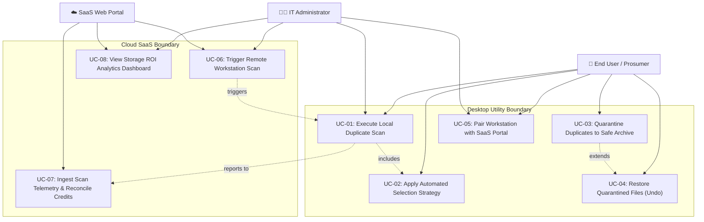

# 🎯 Phase 10: Use Cases & Operational Scenarios

> **Document Code:** UC-DOC-001  
> **Project:** Duplicate Bin Ecosystem  
> **Format:** Alistair Cockburn Formal Use Case Specification  
> **Diagramming:** Mermaid UML Use Case Map  

---

## 1. System Use Case Diagram

---

## 2. Formal Use Case Specifications

### UC-01: Execute Local Duplicate Scan
- **Use Case ID:** UC-01
- **Use Case Name:** Execute Local Duplicate Scan
- **Primary Actor:** End User / IT Administrator
- **Goal:** Scan a specified file system directory, identify duplicate clusters, and calculate potential space savings without altering source files.
- **Preconditions:** Target directory path is mounted and readable by the operating system user.
- **Trigger:** User selects directory (via folder browser or drag-and-drop) and initiates scan.
- **Main Success Flow:**
  1. Actor specifies root directory and clicks "Start Scan".
  2. System validates that the directory path is safe and not an operating system root (`UNSAFE_DIRS`).
  3. System collects all candidate files recursively.
  4. System executes Pass 1: groups files by file size ($O(n)$) and discards unique sizes.
  5. System executes Pass 2: checks SQLite persistent hash cache for matching `(path, size, mtime)`.
  6. For cache misses, system streams byte chunks and computes cryptographic hashes (SHA-256).
  7. System applies Union-Find clustering to group identical hashes.
  8. System renders duplicate clusters in the GUI tree with recoverable byte counts.
- **Alternative Flow (Filter Constraints Applied):**
  - At Step 1, Actor specifies min/max size or file extension filters. System excludes non-matching files during initial directory traversal.
- **Exception Flow 1 (Restricted Directory):**
  - At Step 2, Actor selects `C:\Windows` or `/etc`. System displays error: *"Scanning operating system root directories is prohibited for safety reasons"* and halts.
- **Exception Flow 2 (Permission Denied):**
  - During Step 3, system encounters a locked or restricted subfolder. System logs a warning to the audit console, skips the locked item, and continues scanning remaining files.
- **Postconditions:** Duplicate groups displayed in GUI; persistent hash cache updated in SQLite; zero source files modified.
- **Business Rules:** BRULE-02 (System Protection Rule).

---

### UC-02: Apply Automated Selection Strategy
- **Use Case ID:** UC-02
- **Use Case Name:** Apply Automated Selection Strategy
- **Primary Actor:** End User / Prosumer
- **Goal:** Automatically select redundant files for removal across all duplicate groups according to a predetermined heuristic rule.
- **Preconditions:** Duplicate clusters identified and loaded into active memory.
- **Trigger:** Actor selects a strategy option from the UI dropdown (e.g., "Keep Best Quality", "Keep Newest").
- **Main Success Flow:**
  1. Actor chooses a strategy from the selection dropdown.
  2. System iterates through each duplicate cluster.
  3. System evaluates metadata attributes (creation date, modification date, path depth, file quality).
  4. System designates exactly one file per cluster as the "Original / Keep" master.
  5. System checks the removal box for all other redundant copies in the cluster.
  6. System updates the UI tree and recalculates the total "Selected for Removal" byte counter.
- **Alternative Flow (Manual Override):**
  - Actor manually checks or unchecks specific items. System updates selection counters while enforcing the rule that at least one file remains unselected.
- **Exception Flow (Attempting to Select All Copies):**
  - Actor attempts to check every file in a duplicate cluster. System prevents the final checkbox from being checked and displays: *"At least one copy must be preserved"*.
- **Postconditions:** Files marked for archiving; total recoverable bytes dynamically calculated.
- **Business Rules:** BRULE-01 (Master Preservation Rule).

---

### UC-03: Quarantine Duplicates to Safe Archive
- **Use Case ID:** UC-03
- **Use Case Name:** Quarantine Duplicates to Safe Archive
- **Primary Actor:** End User / IT Administrator
- **Goal:** Move all selected duplicate files into a safe local quarantine folder, preserving original directory structure and reclaiming active disk space.
- **Preconditions:** At least one duplicate file is checked for removal; safe archive root directory exists or can be created.
- **Trigger:** Actor clicks "Archive Selected Files" button.
- **Main Success Flow:**
  1. Actor clicks "Archive Selected Files".
  2. System presents confirmation dialog detailing the number of files and total gigabytes to be archived.
  3. Actor confirms the operation.
  4. System generates a timestamped quarantine directory inside `~/.duplicate_bin/archive/<YYYYMMDD_HHMMSS>/`.
  5. System moves each selected file from its source directory to the quarantine directory, recreating the relative path hierarchy.
  6. System writes an audit manifest (`manifest.json`) recording original absolute paths and destination paths.
  7. System enables the "Restore" button (`Ctrl+Z`) and updates the results tree.
- **Alternative Flow (Disk Full on Archive Target):**
  - If the drive hosting `~/.duplicate_bin` lacks sufficient space, system halts the operation, rolls back files moved in the current batch, and notifies the user.
- **Postconditions:** Selected duplicate files removed from source directories; active disk space reclaimed; manifest written.
- **Business Rules:** BRULE-05 (Reversibility Rule).

---

### UC-04: Restore Quarantined Files (Undo)
- **Use Case ID:** UC-04
- **Use Case Name:** Restore Quarantined Files (Undo)
- **Primary Actor:** End User
- **Goal:** Revert a previous archive operation by returning all quarantined files back to their exact original disk locations.
- **Preconditions:** A completed archive operation exists in the active session or archive tree.
- **Trigger:** Actor presses `Ctrl+Z` or clicks "Restore" in the Archive Tab.
- **Main Success Flow:**
  1. Actor triggers restore action.
  2. System reads the manifest file corresponding to the target archive batch.
  3. For each file in the manifest, system verifies that the target parent directory exists (or recreates it).
  4. System moves the file from the quarantine folder back to its original absolute file path.
  5. System verifies file size and integrity.
  6. System removes the archived batch directory and updates the UI status.
- **Exception Flow (Original Path Occupied):**
  - If a new file has since been created at the original path, system prompts the user to overwrite, rename, or cancel.
- **Postconditions:** All archived files restored to original locations; quarantine batch cleared.

---

### UC-05: Pair Workstation with SaaS Portal
- **Use Case ID:** UC-05
- **Use Case Name:** Pair Workstation with SaaS Portal
- **Primary Actor:** IT Administrator / Device Owner
- **Goal:** Authenticate and bind a local desktop workstation to a central SaaS cloud account using an expiring numeric pairing code.
- **Preconditions:** SaaS account created and logged in; local Duplicate Bin daemon installed.
- **Trigger:** Administrator initiates pairing command on workstation (`python run.py pair <code>`).
- **Main Success Flow:**
  1. Administrator logs into web portal and requests a pairing code.
  2. Portal displays 6-digit code (e.g., "729104", valid for 300 seconds).
  3. Administrator executes `python run.py pair 729104` in workstation terminal.
  4. Client agent generates unique machine UUID `device_id` and queries OS details.
  5. Client agent sends `POST /api/devices/pair` to cloud backend.
  6. Cloud backend verifies pairing code in memory store.
  7. Cloud backend generates 64-character hex `pairing_token` and inserts/updates `Device` table.
  8. Cloud backend returns `device_id` and `pairing_token` to agent.
  9. Agent persists credentials to `~/.duplicate_bin/agent_config.json`.
- **Exception Flow (Pairing Code Expired):**
  - If > 300 seconds elapsed, backend returns `HTTP 400: Pairing code expired`. Agent displays message asking user to generate a fresh code on the web portal.
- **Postconditions:** Workstation registered in cloud database; authorized for WebSocket command relays.
- **Business Rules:** BRULE-03 (Pairing Code Expiration Rule).
