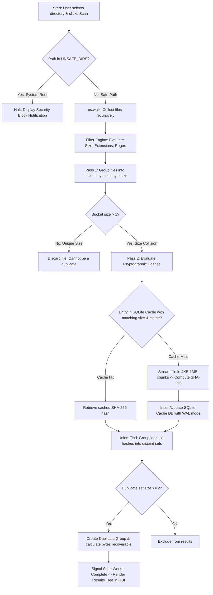
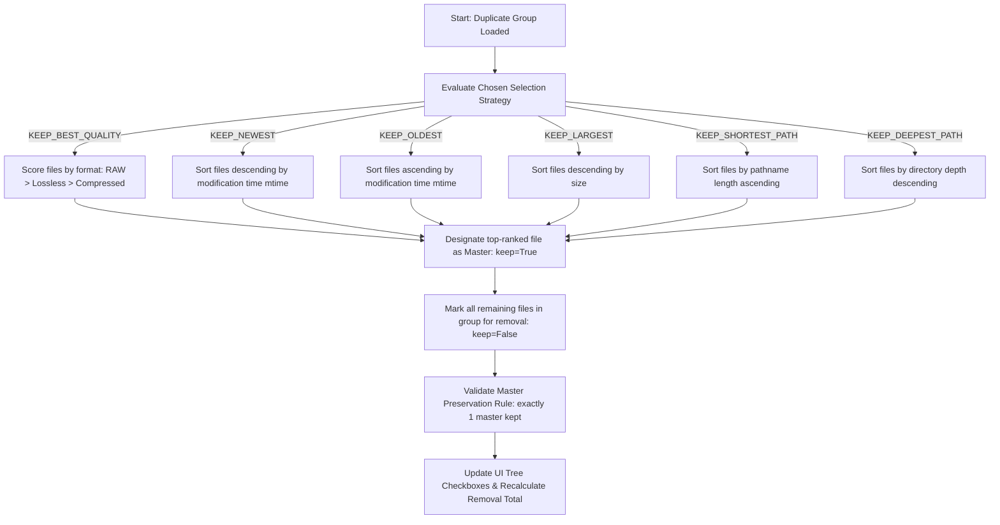
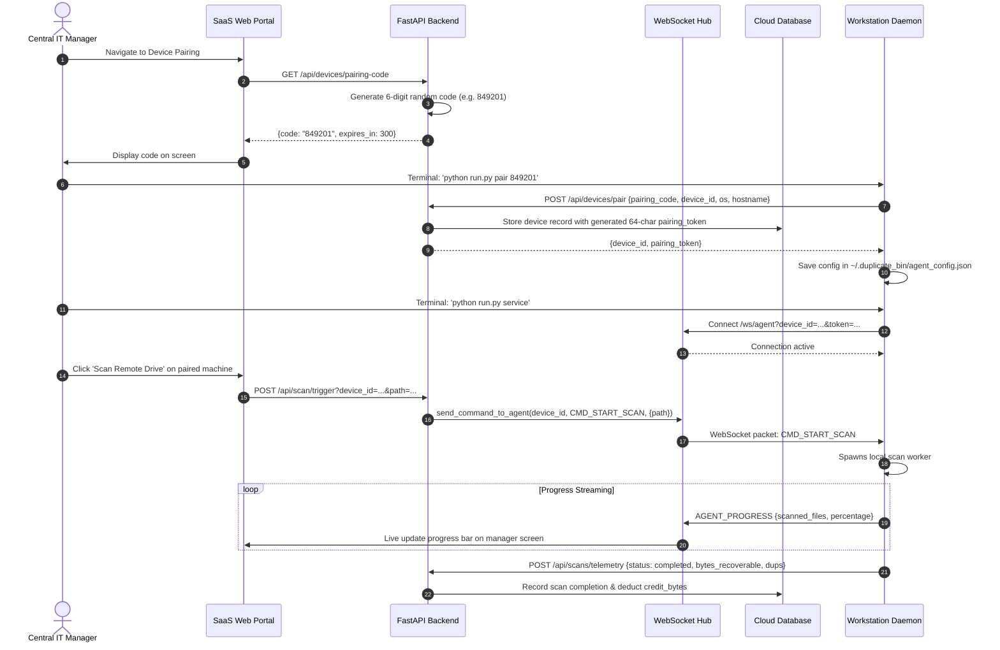
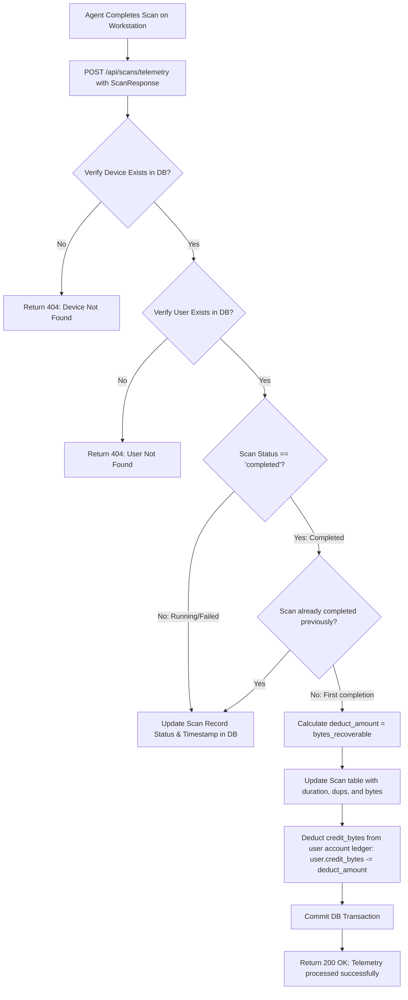

# 🔀 Phase 11: Business & Technical Process Flows

> **Document Code:** PF-DOC-001  
> **Project:** Duplicate Bin Ecosystem  
> **Format:** End-to-End Workflow Specifications with Mermaid Sequence & Flowchart Diagrams  

---

## 1. Process Map: System Workflow Portfolio

1. **Workflow 1 (WF-01):** End-to-End Multi-Pass Duplicate Detection Lifecycle
2. **Workflow 2 (WF-02):** Automated Selection Strategy Decision Flow
3. **Workflow 3 (WF-03):** Safe Archiving & Disaster Rollback Pipeline
4. **Workflow 4 (WF-04):** SaaS Workstation Pairing & WebSocket Command Dispatch
5. **Workflow 5 (WF-05):** Scan Telemetry Processing & Credit Balance Reconciliation

---

## 2. Workflow 1 (WF-01): Multi-Pass Duplicate Detection Lifecycle



- **Process Name:** Multi-Pass Duplicate Detection Lifecycle
- **Purpose:** Maximize scanning velocity by eliminating non-duplicate files prior to expensive disk reads and hash computations.
- **Actors:** Prosumer, IT Systems Administrator, Detection Engine.
- **Trigger:** Folder drag-and-drop or clicking "Start Scan" (`Ctrl+S`).
- **Decision Points:**
  - Is directory a protected OS root? (Abort if true).
  - Does file match filter rules? (Skip if false).
  - Is file size unique across corpus? (Discard in Pass 1).
  - Does file signature exist in SQLite cache? (Bypass disk read if true).
- **Exceptions:** Permission denied (skip and log), corrupted cache file (re-init SQLite WAL).
- **Outputs:** Categorized duplicate groups, recoverable gigabytes calculation, updated cache.
- **Business Rules:** BRULE-02 (System Protection).

---

## 3. Workflow 2 (WF-02): Automated Selection Strategy Decision Flow



- **Process Name:** Automated Selection Strategy Decision Flow
- **Purpose:** Deterministically determine which file copy to keep and which to quarantine, eliminating manual human decision fatigue.
- **Actors:** End User, Selection Engine.
- **Trigger:** Strategy selection dropdown changed in GUI.
- **Decision Points:**
  - Evaluates heuristic scoring criteria (resolution, timestamp, path depth).
  - Enforces invariant that at least one file remains unselected.
- **Outputs:** Boolean selection flags on all duplicate tree nodes.
- **Business Rules:** BRULE-01 (Master Preservation).

---

## 4. Workflow 3 (WF-03): Safe Archiving & Disaster Rollback Pipeline

```mermaid
sequenceDiagram
    autonumber
    actor User as End User
    participant UI as Desktop GUI
    participant Arch as SafeArchiveSystem
    participant FS as Local File System

    User->>UI: Clicks 'Archive Selected Files'
    UI->>UI: Prompt confirmation modal with file count & total GB
    User->>UI: Confirms action
    UI->>Arch: archive_files(selected_items)
    Arch->>FS: Create quarantine directory ~/.duplicate_bin/archive/<timestamp>/
    loop For each selected file
        Arch->>FS: Resolve realpath (boundary check)
        Arch->>FS: Move file from source path to quarantine directory
        Arch->>Arch: Append original and new path to manifest
    end
    Arch->>FS: Write manifest.json to quarantine folder
    Arch-->>UI: Operation complete
    UI->>User: Reclaimed storage displayed; enable 'Undo' (Ctrl+Z)

    opt User triggers Undo (Disaster Recovery)
        User->>UI: Presses Ctrl+Z
        UI->>Arch: restore_latest_archive()
        Arch->>FS: Read manifest.json
        loop For each item in manifest
            Arch->>FS: Recreate original parent folder if missing
            Arch->>FS: Move file back to original source path
        end
        Arch->>FS: Delete empty quarantine directory
        Arch-->>UI: Restore complete
        UI->>User: Confirmation: 100% files restored to original locations
    end
```

- **Process Name:** Safe Archiving & Disaster Rollback Pipeline
- **Purpose:** Prevent accidental data loss by quarantining rather than deleting files, providing a single-click undo mechanism.
- **Actors:** End User, Archive Engine, Host OS File System.
- **Trigger:** "Archive Selected" button clicked or `Ctrl+Z` undo shortcut pressed.
- **Business Rules:** BRULE-05 (Reversibility Rule).

---

## 5. Workflow 4 (WF-04): SaaS Workstation Pairing & Remote Scan Dispatch



---

## 6. Workflow 5 (WF-05): Scan Telemetry & Credit Balance Reconciliation



- **Process Name:** Scan Telemetry & Credit Balance Reconciliation
- **Purpose:** Ingest scan outcome metrics and atomically debit user deduplication credits.
- **Actors:** Desktop Agent Daemon, FastAPI Backend, SQLAlchemy Session.
- **Business Rules:** BRULE-04 (Credit Ledger Debit Rule).
