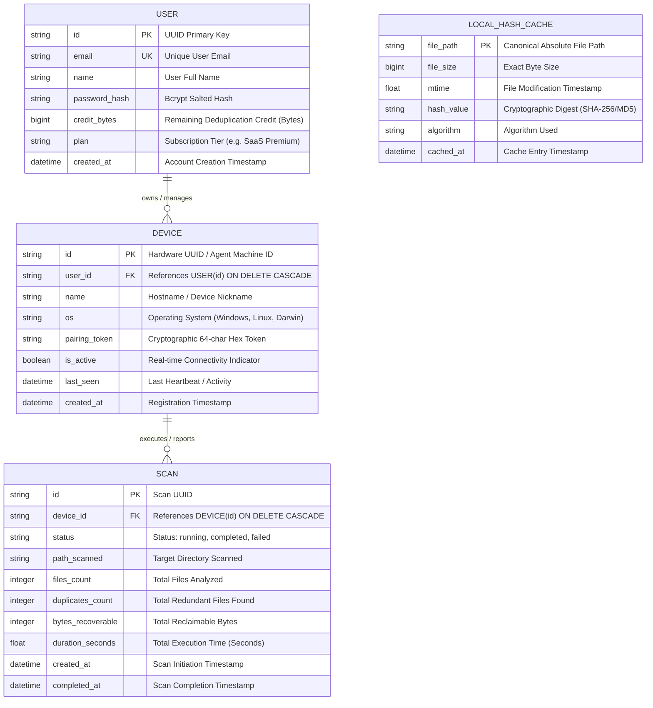

# 🗄️ Phase 13: Data Architecture & Entity Relationship Analysis

> **Document Code:** DA-DOC-001  
> **Project:** Duplicate Bin Ecosystem  
> **Scope:** Cloud Relational Schema (PostgreSQL/SQLite) & Desktop Local Persistence (SQLite WAL / JSON)  
> **Diagramming:** Mermaid Entity Relationship Diagram (ERD)  

---

## 1. Unified Data Architecture

The Duplicate Bin data tier is architected into two distinct tiers:
1. **Local Desktop Tier (Offline-First):** SQLite database (`~/.cache/duplicate-bin/hash_cache.db`) operating with Write-Ahead Logging (WAL) for high-concurrency file hash caching, and JSON manifests for quarantine rollback tracking.
2. **Cloud SaaS Tier (Centralized Fleet Management):** Relational database (SQLAlchemy models in `backend/app/models.py`) tracking user identities, paired devices, telemetry history, and credit ledgers.

---

## 2. Entity Relationship Diagram (ERD)

---

## 3. Business Entity Profiles

### 3.1 Entity: `User`
- **Business Meaning:** Represents the customer entity (individual creator or corporate account holder) who owns software licenses and holds deduplication credits.
- **Primary Purpose:** Authentication, billing ledger maintenance, and fleet ownership root.
- **Key Attributes:**
  - `credit_bytes` (BigInteger): The core monetization balance. Default allocation is $10,737,418,240$ bytes (10 GB free tier).
  - `plan` (String): Controls enterprise features (e.g., "SaaS Premium", "Team Starter").
- **Data Owner:** Account / Finance Domain.
- **Persistence:** Cloud database `users` table.

### 3.2 Entity: `Device`
- **Business Meaning:** Represents a physical desktop or server running the Duplicate Bin background agent.
- **Primary Purpose:** Enforces authorization boundaries for remote scan execution and routes WebSocket commands.
- **Key Attributes:**
  - `pairing_token` (String): Secure 64-character secret generated during the 6-digit handshake. Validates incoming WebSocket requests.
  - `is_active` (Boolean): Dynamically derived based on live WebSocket registry status.
- **Data Owner:** Systems Engineering / IT Admin Domain.
- **Persistence:** Cloud database `devices` table.

### 3.3 Entity: `Scan`
- **Business Meaning:** Represents an individual deduplication audit event executed on a specific device.
- **Primary Purpose:** Ingests operational telemetry to drive dashboard ROI charts and trigger credit deductions.
- **Key Attributes:**
  - `bytes_recoverable` (Integer): The measured duplicate file volume. Serves as the mathematical basis for credit deduction.
  - `duplicates_count` (Integer): Total redundant files discovered.
  - `duration_seconds` (Float): Scan execution time, used for system health and speed benchmarks.
- **Data Owner:** Telemetry & Analytics Domain.
- **Persistence:** Cloud database `scans` table.

### 3.4 Entity: `LocalHashCache` (Client SQLite)
- **Business Meaning:** Client-side digital fingerprint ledger that avoids redundant disk reads.
- **Primary Purpose:** Accelerates rescanning of unchanged files from minutes to milliseconds.
- **Validation Key:** Triple compound check `(file_path, file_size, mtime)`. If the OS modification timestamp or file size changes, the cache entry is invalidated.
- **Persistence:** Embedded SQLite database (`hash_cache.db`) with Write-Ahead Logging.
