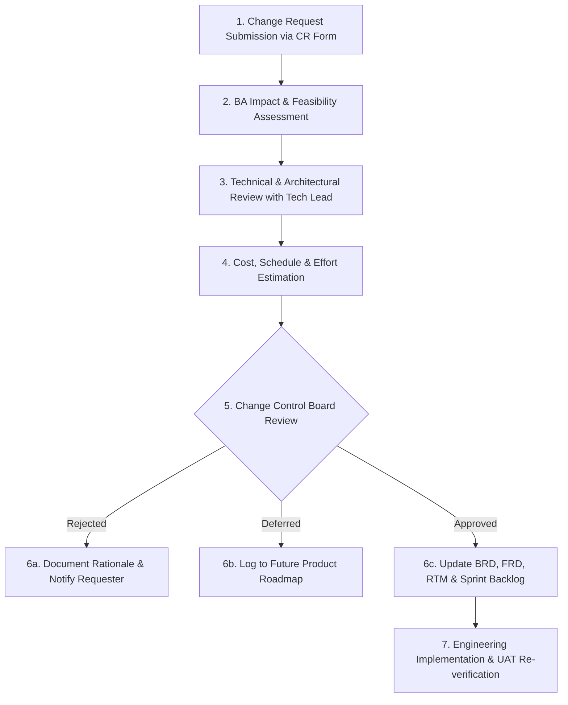

# 🔄 Phase 19: Change Request Log & Change Governance

> **Document Code:** CR-LOG-001  
> **Project:** Duplicate Bin Ecosystem  
> **Methodology:** Formal Change Control Board (CCB) Process  
> **Notice:** Scenarios below include realistic simulated examples clearly marked as **[SIMULATED INTERVIEW SCENARIO]** for interview demonstration.  

---

## 1. Formal Change Control Procedure

When a requirement change is proposed during the software development lifecycle, the Business Analyst drives the structured change management governance framework:

---

## 2. Change Request Ledger

| CR ID | Change Title | Requester | Classification | Impact Summary | Decision Status | Decision Date |
|---|---|---|---|---|---|---|
| **CR-001** | Transition from SQLite to PostgreSQL for SaaS Backend | Lead Architect | Technical Infrastructure | Schema compatibility verified via SQLAlchemy; zero API changes required. | **APPROVED** | Sprint 4 |
| **CR-002** | Adjust Free Deduplication Tier from 5 GB to 10 GB | Product Owner | Business / Monetization | Increased database initial credit column; lowers onboarding friction. | **APPROVED** | Sprint 4 |
| **CR-003** | Cloud API Direct In-Place Crawling (Google Drive / OneDrive) | Enterprise Sales | Product Feature Scope | **[SIMULATED INTERVIEW SCENARIO]** High complexity; deferred to Phase 3 Roadmap. | **DEFERRED** | Sprint 5 Planning |
| **CR-004** | Hard-Link Deduplication Mode on NTFS / APFS / EXT4 | IT Admin User | Core Engine Feature | **[SIMULATED INTERVIEW SCENARIO]** Replaces duplicates with OS hard links instead of archiving. | **APPROVED (For v1.1)** | Sprint 5 Planning |

---

## 3. Detailed Change Requests

### CR-002: Adjust Free Deduplication Credit from 5 GB to 10 GB [ACTUAL PROJECT EVENT]
- **Requester:** Product Owner (Marcus)
- **Description:** Increase the default credit byte grant on user registration from 5 GB ($5,368,709,120$ bytes) to 10 GB ($10,737,418,240$ bytes).
- **Business Rationale:** Strategy documents originally proposed 5 GB, but early prosumer user feedback indicated that photographers shoot average batches of 8-10 GB per session. A 5 GB limit blocked users mid-scan during their very first evaluation, causing premature churn.
- **BA Impact Assessment:**
  - *Requirement Impact:* Updates BR-003, FR-012, and schema in `backend/app/models.py#L13`.
  - *Engineering Effort:* Minimal (1 line modification in SQLAlchemy model default parameter).
  - *Revenue Impact:* Increases customer trust and allows prospective users to experience a complete cleanup workflow before purchasing a $4.99 credit pack.
- **CCB Decision:** **APPROVED unanimously**.

---

### CR-003: Cloud API Direct In-Place Crawling [SIMULATED INTERVIEW SCENARIO]
- **Requester:** Enterprise Sales Representative
- **Description:** Implement direct cloud API connectors allowing Duplicate Bin SaaS to scan Google Drive, Dropbox, and OneDrive accounts without requiring files to be synced to a local computer drive.
- **Business Rationale:** Multiple prospective enterprise clients want to clean up cloud storage directly from their web browser.
- **BA Impact Assessment:**
  - *Requirement Impact:* Adds new module `CloudConnectorEngine`, requires OAuth2 multi-tenant cloud credential storage, background cloud worker clusters, and handles cloud API rate limiting (Google Drive API quota).
  - *Engineering Effort:* Estimated 180 story points (6 sprints); requires dedicated cloud infrastructure budget.
  - *Scope Evaluation:* Deviates significantly from current v0.2.0 local desktop architecture.
- **CCB Decision:** **DEFERRED to Phase 3 Enterprise Roadmap**. Current users are advised to mount cloud drives as local virtual file streams (Google Drive for Desktop / OneDrive Files On-Demand).

---

### CR-004: Hard-Link Deduplication Mode [SIMULATED INTERVIEW SCENARIO]
- **Requester:** Corporate IT Administrator (Marcus)
- **Description:** Add an alternative cleanup action to "Archive" called "Create Hard Links". When selected, redundant file copies are replaced with operating system hard links (`os.link`) pointing to the master file's physical disk sectors.
- **Business Rationale:** On shared office servers, existing project directory references remain valid and accessible, but disk consumption drops to the size of a single copy.
- **BA Impact Assessment:**
  - *Requirement Impact:* Adds new selection action in `archive.py` and UI dialog.
  - *Technical Constraint:* Hard links only function across the same physical disk partition; cannot cross filesystems.
  - *Engineering Effort:* Moderate (20 story points; 1 sprint).
- **CCB Decision:** **APPROVED for release in Milestone v1.1.0**.
