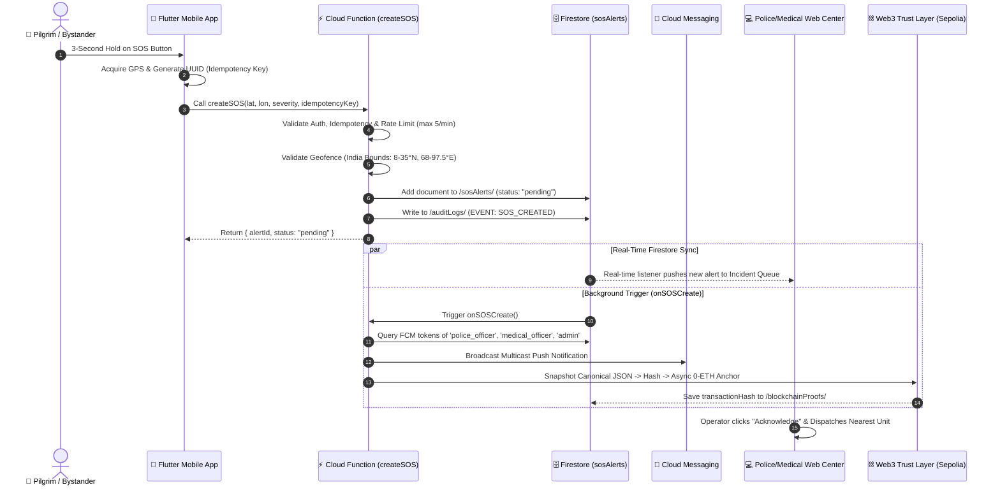
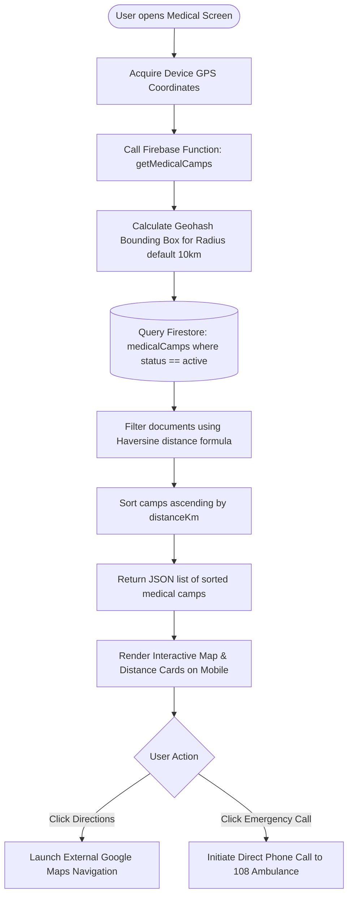
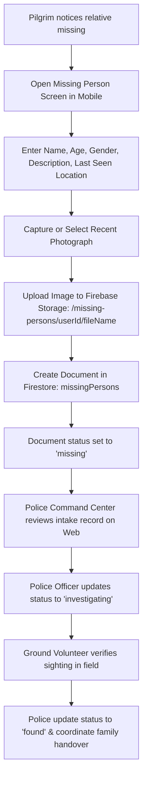

# Business Process Analysis, As-Is / To-Be & Gap Analysis — WariMitra

> **Document ID:** WM-BPA-004  
> **Classification:** Business Process Modeling & Gap Engineering  
> **Standard:** BPMN 2.0 & BABOK v3 Chapter 7 (Requirements Analysis and Design Definition)  
> **Target Audience:** Senior Business Analysts, Lead Process Engineers, Solution Architects, Interview Panels  
> **Source Evidence:** `functions/src/index.ts`, `docs/BRD.md`, `docs/FRD.md`, `docs/Feature_Workflows.md`, `mobile/lib/screens/`  

---

## 1. Process Classification Framework

To maintain absolute analytical integrity, all processes within this document are categorized into one of three classifications:
1. **[ACTUAL IMPLEMENTED PROCESS]:** Directly verified through executing source code, database triggers, API contracts, or UI logic in this repository.
2. **[INFERRED PROCESS]:** Logically deduced from database schemas, roles, security rules, and architectural comments.
3. **[PROPOSED PROCESS / GAP]:** Recommended future operational enhancements to close unmitigated real-world gaps.

---

## 2. Process Flow 1: Emergency SOS Triage & Multicast Dispatch

### 2.1 Process Metadata
* **Classification:** **[ACTUAL IMPLEMENTED PROCESS]**
* **Process Name:** End-to-End Emergency SOS Incident Lifecycle
* **Primary Actors:** Distressed Pilgrim / Bystander (Initiator), Firebase Cloud Functions (System Automation), Police / Medical Responders (Recipients)
* **Trigger:** User performs a 3-second hold on the SOS button in the mobile app.

### 2.2 As-Is vs. To-Be Process Comparison

#### As-Is Current Manual Process
1. Devotee experiences severe acute medical distress or safety hazard.
2. Devotee or bystander yells for help or looks for a nearby volunteer.
3. Bystander walks 500m–2km to find a static police tent or medical relief stall.
4. If a phone is available, bystander dials 108 or 100; call gets queued in regional telecom switch due to network congestion.
5. Bystander describes location using vague landmarks ("near the banyan tree after the petrol pump").
6. Police desk transmits over VHF analog radio; ambulance attempts to navigate uncoordinated pedestrian crowds.
7. **Elapsed Time:** 45 to 90 minutes. High mortality risk during the clinical "Golden Hour".

#### To-Be Automated Process (WariMitra)

### 2.3 Step-by-Step Implementation Detail
1. **Trigger & Input:** Pilgrim holds UI button for 3 seconds. App reads hardware GPS coordinates (`latitude`, `longitude`) via `geolocator`, generates client UUID (`idempotencyKey`), and passes optional `severity` ('low' | 'medium' | 'high' | 'critical') and `description` (`mobile/lib/screens/sos_screen.dart`).
2. **Backend Entry Validation:** `createSOS` callable Cloud Function enforces:
   - *Authentication Check:* Must possess valid Firebase Auth token (`functions/src/index.ts:24-29`).
   - *Idempotency Check:* Queries `sosAlerts` by `idempotencyKey`. If match exists, returns existing `alertId` to prevent duplicate alerts caused by flaky networks (`functions/src/index.ts:43-56`).
   - *Rate Limit Check:* Queries alerts created by `userId` within previous 60,000ms. Throws `resource-exhausted` if count $\ge 5$ (`functions/src/index.ts:59-70`).
   - *Geofence Bounds Check:* Verifies $8.0 \le \text{lat} \le 35.0$ and $68.0 \le \text{lon} \le 97.5$. Rejects invalid or spoofed coordinates outside India (`functions/src/index.ts:73-80`).
3. **Database Insertion & Audit:** Computes 9-character `geohash` for spatial queries, writes new record to `sosAlerts` with `serverTimestamp()`, and writes immutable log to `auditLogs` (`functions/src/index.ts:82-110`).
4. **Asynchronous Multicast Broadcasting:** Background trigger `onSOSCreate` fires:
   - Queries `users` collection for tokens where `userType` $\in$ `['admin', 'police_officer', 'medical_officer']`.
   - Dispatches FCM multicast alert (`functions/src/index.ts:192-218`).
   - Increments singleton counter `analytics/dashboardMetrics.activeSOS` (`functions/src/index.ts:221-224`).
   - Creates cryptographic snapshot, generates SHA-256 hash, and initiates asynchronous Sepolia blockchain anchoring (`functions/src/index.ts:237-264`).
5. **State Transition Lifecycle:** Operator reviews alert on Next.js Command Center, transitions status from `pending` $\rightarrow$ `acknowledged` $\rightarrow$ `dispatched` $\rightarrow$ `resolved`. `onSOSUpdate` trigger detects state changes and anchors an incremental audit proof (`functions/src/index.ts:270-312`).

---

## 3. Process Flow 2: Proximity Medical Camp Discovery & Healthcare Triage

### 3.1 Process Metadata
* **Classification:** **[ACTUAL IMPLEMENTED PROCESS]**
* **Process Name:** Geospatial Medical Relief Discovery & Capacity Routing
* **Primary Actors:** Pilgrim / Field Volunteer (Requester), Medical Officer (Provider), Cloud Functions Engine
* **Trigger:** Pilgrim or volunteer navigates to Medical Services screen and requests nearby medical camps.

### 3.2 Implemented Process Flow

### 3.3 Business Rules & Logic
* **BR-MED-001 (Active Camp Filtering):** Only camps with `status == 'active'` are evaluated in geospatial bounds (`functions/src/index.ts:145`).
* **BR-MED-002 (Search Radius Constraint):** Default radius is 10 km. Camps exceeding bounding box or computed Haversine distance are discarded (`functions/src/index.ts:129,163-169`).
* **BR-MED-003 (Telemetry Visibility):** Returned payload exposes camp `capacity`, `currentPatients`, and `staffCount`, enabling users to avoid overloaded facilities (`ARCHITECTURE.md:215`).

---

## 4. Process Flow 3: Missing Person Intake & Family Locator Circle

### 4.1 Process Metadata
* **Classification:** **[ACTUAL IMPLEMENTED PROCESS]**
* **Process Name:** Missing Person Intake & Dynamic Family Tracking
* **Primary Actors:** Family Member / Pilgrim (Reporter), Ground Volunteers & Police (Search Units)
* **Trigger:** Family member realizes a relative is missing or joins a family tracking circle.

### 4.2 Sub-Process A: Ad-Hoc Family Circle Tracking
1. Head of family initiates group creation; system assigns unique 6-character alphanumeric `inviteCode` (`ARCHITECTURE.md:222`).
2. Accompanying family members enter `inviteCode` to join `familyGroups/{groupId}`.
3. Mobile app initiates foreground/background location timer firing every 30 seconds (`location_service.dart`).
4. Device sends latitude, longitude, and device battery level (`VARIMITRA_SPEAKER_CONTEXT.md:155-156`).
5. Family circle map renders pins for all active members. If battery drops below 15%, icon displays low-power indicator to prevent undue panic.

### 4.3 Sub-Process B: Missing Person Reporting & Search

---

## 5. Comprehensive Gap Analysis (As-Is vs. Current Implementation vs. Proposed To-Be)

| Business Domain | Manual As-Is Baseline | Currently Implemented in WariMitra (v2.0) | Identified Gap / Missing Functionality | Proposed To-Be Enhancement |
| :--- | :--- | :--- | :--- | :--- |
| **Distress Triage** | Paper records, delayed VHF police radio broadcasts. | Sub-2s SOS creation, rate-limiting, geofencing, FCM multicast, Web3 audit trail. | Dev-mode Firestore rules currently open for testing (`firestore.rules:55`). | Enforce strict RBAC in `firestore.rules` for production cutover. |
| **Medical Camps** | Static paper patient check-in; no inter-camp awareness. | Geospatial Geohash query within 10 km; camp capacity and patient count models. | Real ambulance telemetry not connected via automated API; dispatch is phone-assisted (108). | Direct integration with State 108 CAD (Computer-Aided Dispatch) telematics API. |
| **Crowd Intelligence** | Visual watchtowers; subjective crowd estimations. | Mathematical heuristics (Little’s Law for queue wait times; NOAA heatstroke index). | No deep learning computer vision or trained neural crowd surge forecasting. | Ingest drone video streams through YOLO/OpenCV crowd density counting models. |
| **Missing Persons** | Loudspeaker announcements and physical bulletin boards. | Digital intake form with photo upload and police status workflow (`missingPersons`). | Matching is manual visual inspection; no automated facial recognition matching. | Integrate Google Cloud Vision / ML Kit for automated facial vector matching. |
| **Connectivity Resilience** | Zero offline capability; complete radio/cellular dependency. | Firestore offline document caching enabled on mobile devices. | Custom SQLite/Isar transactional offline retry queue with background sync is absent. | Implement WorkManager background sync with local SQLite queue for zero-connectivity zones. |

---

## 6. Process Improvement Opportunities (BA Recommendations)

1. **Automated Geofenced Route Deviation Alerts:**  
   *Observation:* Pilgrims often wander off the primary highway corridor onto treacherous rural trails.  
   *Improvement:* Implement a background service monitoring pilgrim coordinates against the pre-mapped Palkhi route polyline (`routes/{routeId}/waypoints`). If deviation exceeds 500 meters, trigger a push notification warning in Marathi.
2. **Dynamic Relief Load Balancing (NGO Matching):**  
   *Observation:* Free food camps (*Annachhatras*) operate independently, resulting in severe food waste in some towns and hunger in others.  
   *Improvement:* Build an algorithmic matching engine in Cloud Functions that pairs real-time crowd concentration heatmaps with reported NGO inventory to recommend optimal kitchen deployment zones.
