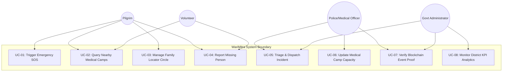

# Formal Use Case Specifications — WariMitra

> **Document Identifier:** WM-UC-010  
> **Classification:** UML Use Case Models & Behavioral Scenarios  
> **Standard:** Cockburn Formal Use Case Template / BABOK v3  
> **Target Audience:** Solution Architects, System Analysts, QA Engineers, Interviewers  
> **Source Evidence:** `functions/src/index.ts`, `ARCHITECTURE.md`, `frontend/src/app/`, `mobile/lib/screens/`  

---

## 1. System Use Case Diagram (UML)

---

## 2. Detailed Use Case Specifications

### Use Case 1: UC-SOS-01 — Trigger Emergency Distress Alert

| Use Case Element | Specification Detail |
| :--- | :--- |
| **Use Case ID** | **UC-SOS-01** |
| **Use Case Name** | Trigger Emergency Distress Alert |
| **Primary Actor** | Pilgrim / Devotee (`pilgrim`) |
| **Secondary Actors** | Police Officer, Medical Officer, Cloud Functions Backend |
| **Goal in Context** | Instantly transmit a high-priority distress alert with device GPS coordinates to emergency responders without text entry. |
| **Preconditions** | 1. User is logged into the mobile application (`context.auth != null`). 2. Device location services (GPS) are active and permissions granted. |
| **Trigger** | Pilgrim presses and continuously holds the circular SOS panic button on `sos_screen.dart` for 3.0 seconds. |
| **Main Success Flow** | 1. Pilgrim presses and holds the circular SOS button. 2. Client UI initiates a 3.0-second radial progress animation and emits continuous haptic feedback. 3. When the 3.0s threshold is reached, client queries hardware GPS and generates a UUIDv4 `idempotencyKey`. 4. Client invokes Firebase Callable Function `createSOS({ latitude, longitude, severity: 'critical', idempotencyKey })`. 5. Backend validates caller authentication. 6. Backend verifies that the `idempotencyKey` has not been previously ingested. 7. Backend verifies that the user has submitted fewer than 5 alerts in the preceding 60 seconds. 8. Backend confirms coordinates fall within India bounds ($8.0 \le \text{lat} \le 35.0, 68.0 \le \text{lon} \le 97.5$). 9. Backend calculates a 9-character Geohash and inserts document into `/sosAlerts/` with status `pending`. 10. Backend inserts an immutable audit event into `/auditLogs/`. 11. Backend returns `{ alertId, status: 'pending' }` to client. 12. Background trigger `onSOSCreate` fires, broadcasting FCM multicast messages to all registered police and medical tokens. 13. Mobile client transitions to "Help on the Way" screen, displaying live status and click-to-call buttons for 108 and 100. |
| **Alternative Flow 1A (Idempotent Retry)** | 4a. Client experiences network timeout and re-invokes `createSOS` with identical `idempotencyKey`. 4b. Backend locates existing document matching the key. 4c. Backend immediately returns existing record ID with message "SOS already exists (duplicate prevented)", bypassing duplicate writes and duplicate FCM alerts. |
| **Exception Flow 1E (Rate Limit Exceeded)** | 7a. User account has submitted $\ge 5$ alerts within the last 60 seconds. 7b. Backend terminates call with `HttpsError('resource-exhausted')`. 7c. Mobile UI displays cooldown warning dialog in Marathi. |
| **Exception Flow 2E (Outside Geofence)** | 8a. Coordinates fail India bounds validation. 8b. Backend terminates call with `HttpsError('failed-precondition')`. 8c. Request is aborted and flagged in audit logs. |
| **Postconditions** | 1. Alert is stored in `sosAlerts` with status `pending`. 2. Real-time incident appears on Command Center web queues. 3. SHA-256 hash is computed and queued for Sepolia blockchain anchoring. |
| **Business Rules** | `BRULE-001` (Idempotency), `BRULE-002` (Rate Limiting), `BRULE-003` (Geofencing). |
| **Technical Traceability** | `mobile/lib/screens/sos_screen.dart`, `functions/src/index.ts:20-116`. |

---

### Use Case 2: UC-MED-02 — Proximity Medical Camp Discovery

| Use Case Element | Specification Detail |
| :--- | :--- |
| **Use Case ID** | **UC-MED-02** |
| **Use Case Name** | Proximity Medical Camp Discovery |
| **Primary Actor** | Pilgrim / Field Volunteer |
| **Secondary Actor** | Cloud Functions Backend, Google Maps Service |
| **Goal in Context** | Retrieve a list of active medical camps within 10 km sorted by walking proximity, displaying bed availability. |
| **Preconditions** | 1. User is authenticated. 2. Device location is acquired. |
| **Trigger** | User opens the Medical Services tab on the mobile app or web portal. |
| **Main Success Flow** | 1. User taps "Find Medical Camps". 2. Client retrieves current latitude and longitude. 3. Client calls HTTPS Callable Function `getMedicalCamps({ latitude, longitude, radiusKm: 10 })`. 4. Backend computes Geohash bounding boxes for center point and 10,000m radius. 5. Backend queries Firestore collection `medicalCamps` for active facilities matching bounding boxes. 6. Backend calculates exact Haversine distance for each result and discards records $> 10$ km. 7. Backend sorts qualifying camps in ascending order of distance. 8. Backend returns payload containing array of camp objects (`name`, `capacity`, `currentPatients`, `staffCount`, `distanceKm`). 9. Client renders interactive map pins and cards showing distance and open bed count. 10. User clicks "Navigate" to open turn-by-turn directions in Google Maps. |
| **Alternative Flow 2A (Zero Camps Found)** | 6a. No active medical camp exists within 10 km. 6b. Backend returns empty array. 6c. Mobile UI displays message recommending direct call to 108 Emergency Ambulance, displaying one-touch dial button. |
| **Postconditions** | User receives accurate proximity-sorted directory of medical relief facilities. |
| **Technical Traceability** | `functions/src/index.ts:122-177`, `mobile/lib/screens/services_screen.dart`. |

---

### Use Case 3: UC-CMD-03 — Incident Triage & Authority Dispatch

| Use Case Element | Specification Detail |
| :--- | :--- |
| **Use Case ID** | **UC-CMD-03** |
| **Use Case Name** | Incident Triage & Authority Dispatch |
| **Primary Actor** | Police Officer / Medical Dispatcher (`police_officer`, `medical_officer`) |
| **Secondary Actor** | Field Responders, Web3 Trust Layer |
| **Goal in Context** | Acknowledge incoming SOS alert, assign field unit, and transition incident to resolution. |
| **Preconditions** | User is authenticated with verified custom claim `police_officer`, `medical_officer`, or `admin`. |
| **Trigger** | Dispatcher clicks an active incident card in the virtualized incident feed. |
| **Main Success Flow** | 1. Dispatcher reviews incident details (severity, coordinates, distance to nearest patrol unit). 2. Dispatcher clicks "Acknowledge Incident". 3. Web client updates Firestore document status to `acknowledged`. 4. Cloud Function `onSOSUpdate` triggers on document mutation. 5. `onSOSUpdate` creates canonical JSON snapshot, generates SHA-256 hash, and anchors hash to Sepolia testnet. 6. Dispatcher contacts beat marshal via VHF/cellular and updates status to `dispatched`. 7. Ground unit arrives, stabilizes patient/situation, and confirms resolution. 8. Dispatcher updates status to `resolved` with resolution notes. 9. `onSOSUpdate` anchors final `SOS_RESOLVED` event hash onto the blockchain. |
| **Exception Flow 3E (Unauthorized Attempt)** | 3a. A user without authority claims attempts to update status. 3b. Firestore Security Rules evaluate `canManageEmergencies()` to `false`. 3c. Write is rejected with permission-denied error. |
| **Postconditions** | Incident is resolved with complete, immutable blockchain-anchored audit trail. |
| **Technical Traceability** | `frontend/src/app/sos/page.tsx`, `functions/src/index.ts:269-312`, `firestore.rules:26-28`. |
