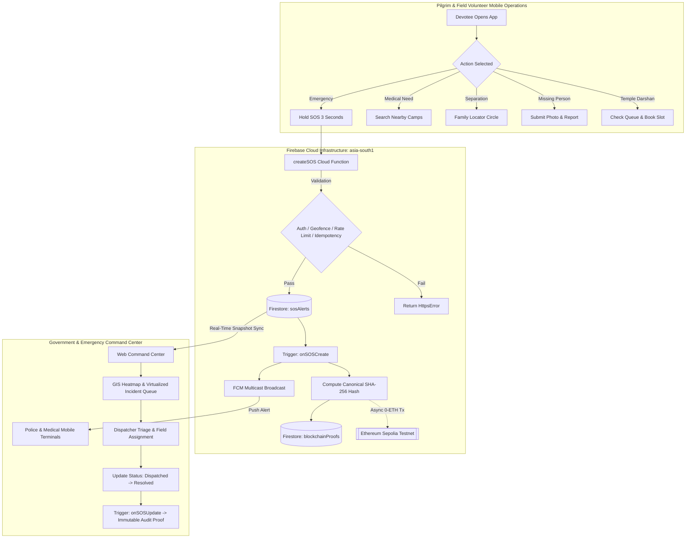
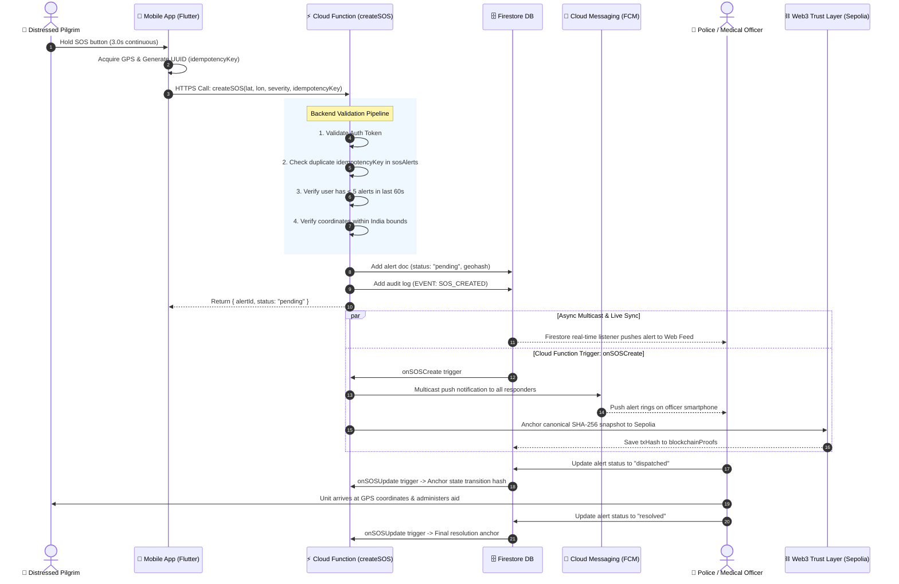
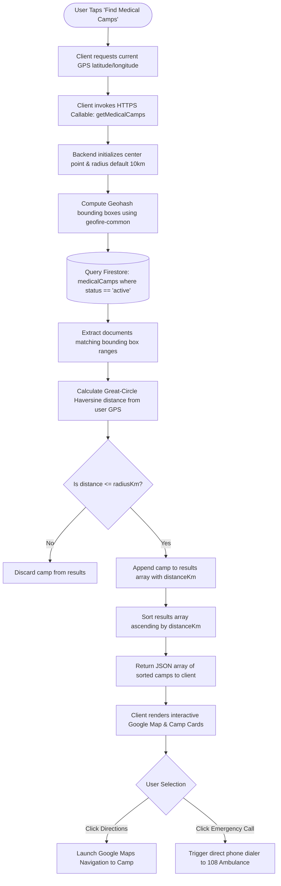
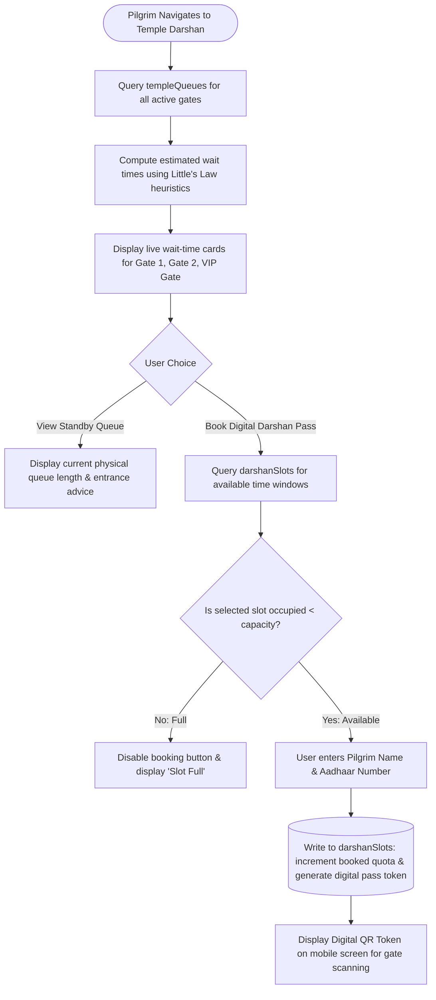

# Business Process Flows & Operational Workflows — WariMitra

> **Document Identifier:** WM-PF-011  
> **Classification:** End-to-End Operational Workflows & BPMN Visualizations  
> **Standard:** BPMN 2.0 / Mermaid Diagrams  
> **Target Audience:** Solution Architects, Operations Leads, Business Analysts, Interview Panels  
> **Source Evidence:** `functions/src/index.ts`, `ARCHITECTURE.md`, `frontend/src/app/`, `mobile/lib/screens/`  

---

## 1. High-Level Operational Architecture Workflow

---

## 2. Detailed Workflow 1: End-to-End SOS Incident Lifecycle

### 2.1 Purpose & Scope
Governs the capture, validation, persistent recording, multicast alerting, tactical dispatch, and cryptographically verified resolution of life-threatening emergencies.

### 2.2 Operational Flow Diagram

---

## 3. Detailed Workflow 2: Proximity Medical Radar & Camp Triage

### 3.1 Purpose & Scope
Enables patients and ground volunteers to query the nearest available medical relief camps within a dynamic walking radius, factoring in real-time bed capacity.

### 3.2 Operational Flow Diagram

---

## 4. Detailed Workflow 3: Family Circle Tracking & Missing Persons Intake

### 4.1 Purpose & Scope
Prevents family dispersion during high-density evening halts and provides an accelerated photo-intake mechanism to locate lost relatives.

### 4.2 Operational Flow Diagram

```mermaid
flowchart TD
    subgraph FamilyCircleSetup [1. Ad-Hoc Family Circle Setup]
        FC1[Group Leader clicks 'Create Family Circle'] --> FC2[System generates unique 6-char code e.g. WARI07]
        FC2 --> FC3[Members enter code WARI07 in their app]
        FC3 --> FC4[(Firestore: Add userId to familyGroups.memberIds)]
        FC4 --> FC5[App initiates background location timer every 30s]
        FC5 --> FC6[(Write current lat, lon, battery to users/userId/liveLocation)]
        FC6 --> FC7[All circle members view live pins on shared map]
    end

    subgraph MissingPersonWorkflow [2. Missing Person Intake & Recovery]
        MP1[Family member notices relative missing] --> MP2[Open Missing Persons Screen]
        MP2 --> MP3[Fill Name, Age, Description, Last Seen Location]
        MP3 --> MP4[Upload Photo from Gallery/Camera]
        MP4 --> MP5[(Store image in Firebase Storage: /missing-persons/)]
        MP5 --> MP6[(Create document in Firestore: missingPersons with status 'missing')]
        MP6 --> MP7[Police Command Center reviews intake on Web Portal]
        MP7 --> MP8[Police update status to 'investigating']
        MP8 --> MP9[Field Volunteer spots person & contacts police]
        MP9 --> MP10[Police update status to 'found' & coordinate family reunion]
    end
```

---

## 5. Detailed Workflow 4: Temple Queue Monitoring & Slot Booking

### 5.1 Purpose & Scope
Monitors crowd queue length across Pandharpur temple gates to compute waiting time estimates and allow pilgrims to book digital Darshan passes.

### 5.2 Operational Flow Diagram

---

## 6. Summary of Operational Traceability

The workflows modeled above represent the primary operational paths implemented in the codebase. By decoupling ground telemetry from backend event processing and frontend visualization, WariMitra guarantees continuous service availability even under intermittent field conditions.
