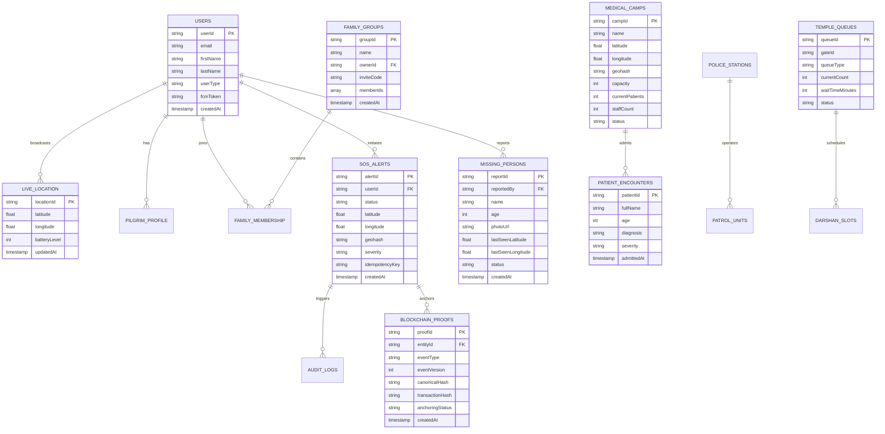

# Data Architecture, Entity Analysis & ER Modeling — WariMitra

> **Document Identifier:** WM-DAT-013  
> **Classification:** Enterprise Data Model & Entity-Relationship Specifications  
> **Database Paradigm:** Cloud Firestore NoSQL Document Database (`asia-south1`)  
> **Target Audience:** Data Architects, Database Administrators, Technical Business Analysts, Solution Architects  
> **Source Evidence:** `ARCHITECTURE.md:188-263`, `firestore.rules:30-185`, `functions/src/index.ts`  

---

## 1. Data Architecture Strategy

WariMitra is architected around **Cloud Firestore**, a globally distributed, document-based NoSQL database optimized for high-concurrency real-time synchronization, mobile offline caching, and sub-500ms read latency.

### 1.1 Key Data Design Patterns:
1. **Document-Collection Hierarchies:** Deep relational joins are avoided; core business entities exist in root collections, while high-frequency child data (e.g., live GPS pings and clinic patient records) exist in isolated subcollections.
2. **Geospatial Indexing via Geohash:** Every geographic entity stores a 9-character string Geohash enabling hierarchical bounding-box range scans (`startAt` / `endAt`) across latitude/longitude surfaces without requiring heavy spatial database extensions.
3. **Optimized Aggregation Singletons:** Costly continuous full-collection scans are replaced by scheduled background aggregation functions that write to singleton documents (e.g., `analytics/dashboardMetrics`).
4. **Non-Destructive Audit Trail:** Operational collections preserve immutable history; `auditLogs` and `blockchainProofs` maintain append-only invariants enforced by database security rules.

---

## 2. Entity-Relationship Diagram (ERD)

---

## 3. Core Business Entities & Usage Profiles

### Entity 1: `users`
* **Business Meaning:** Master registry of all human actors interacting with the WariMitra platform.
* **Purpose:** Manages authentication identity, role-based authorization claims, and device push notification tokens.
* **Data Owner:** System Administration / User Account Holder.
* **Key Fields:** `userId`, `email`, `firstName`, `lastName`, `userType` (`pilgrim` | `volunteer` | `dindi_leader` | `medical_officer` | `police_officer` | `ngo` | `admin`), `fcmToken`, `createdAt`.
* **Relationships:** One-to-One with `pilgrims/profile`; One-to-Many with `liveLocation`, `sosAlerts`, and `missingPersons`.

### Entity 2: `sosAlerts`
* **Business Meaning:** Official emergency distress incidents initiated by pilgrims or field personnel.
* **Purpose:** Represents the lifecycle of an emergency from trigger to field triage, dispatch, and final resolution.
* **Data Owner:** Police Command Center & Chief Medical Officer.
* **Key Fields:** `alertId`, `userId`, `status` (`pending` | `acknowledged` | `dispatched` | `resolved`), `latitude`, `longitude`, `geohash`, `severity` (`low` | `medium` | `high` | `critical`), `idempotencyKey`, `createdAt`, `createdAtClient`.
* **Indexes Enforced:** `(status, createdAt DESC)`, `(userId, createdAt DESC)`, `(severity, createdAt DESC)`.

### Entity 3: `medicalCamps`
* **Business Meaning:** Physical medical relief tents, mobile clinics, and hospital triage posts along the pilgrimage highway.
* **Purpose:** Geospatial tracking of healthcare facilities, bed capacity, staffing levels, and patient admissions.
* **Data Owner:** District Health Department / Medical Camp Superintendent.
* **Key Fields:** `campId`, `name`, `latitude`, `longitude`, `geohash`, `capacity`, `currentPatients`, `staffCount`, `status` (`active` | `inactive`).
* **Subcollection:** `patients/` recording individual clinical encounters.

### Entity 4: `familyGroups`
* **Business Meaning:** Ad-hoc travel tracking cohorts formed by families or dindi contingents.
* **Purpose:** Enables private location-sharing and tracking among traveling members.
* **Data Owner:** Group Creator / Dindi Leader.
* **Key Fields:** `groupId`, `name`, `ownerId`, `inviteCode` (unique 6-character alphanumeric string), `memberIds` (array of UIDs), `createdAt`.

### Entity 5: `missingPersons`
* **Business Meaning:** Formal reports of missing, lost, or separated pilgrims.
* **Purpose:** Captures biometric photographs and physical descriptions to aid police and volunteer searches.
* **Data Owner:** Solapur/Pune District Police Crime & Missing Persons Bureau.
* **Key Fields:** `reportId`, `name`, `age`, `category` (`child` | `elderly` | `adult`), `lastSeenLatitude`, `lastSeenLongitude`, `photoUrl`, `status` (`missing` | `investigating` | `found`), `reportedBy`, `createdAt`.

### Entity 6: `blockchainProofs`
* **Business Meaning:** Cryptographic certification of critical state transitions in emergency incidents.
* **Purpose:** Provides mathematical proof that incident timestamps, locations, and response actions have not been altered.
* **Data Owner:** State Disaster Management Authority / Public Governance Audit.
* **Key Fields:** `proofId`, `eventType`, `entityId`, `eventVersion`, `canonicalHash` (SHA-256), `transactionHash` (Sepolia TxID or null), `anchoringStatus` (`CONFIRMED` | `LOCAL_PROOF_ONLY`), `snapshot` (immutable JSON), `createdAt`.

### Entity 7: `analytics/dashboardMetrics` (Singleton Document)
* **Business Meaning:** Aggregated real-time macro telemetry for the Executive Command Center.
* **Purpose:** Eliminates database read costs by pre-computing system counts via a 1-minute background cron.
* **Key Fields:** `totalPilgrims`, `activeSOS`, `medicalCamps`, `avgQueueTime`, `updatedAt`.
